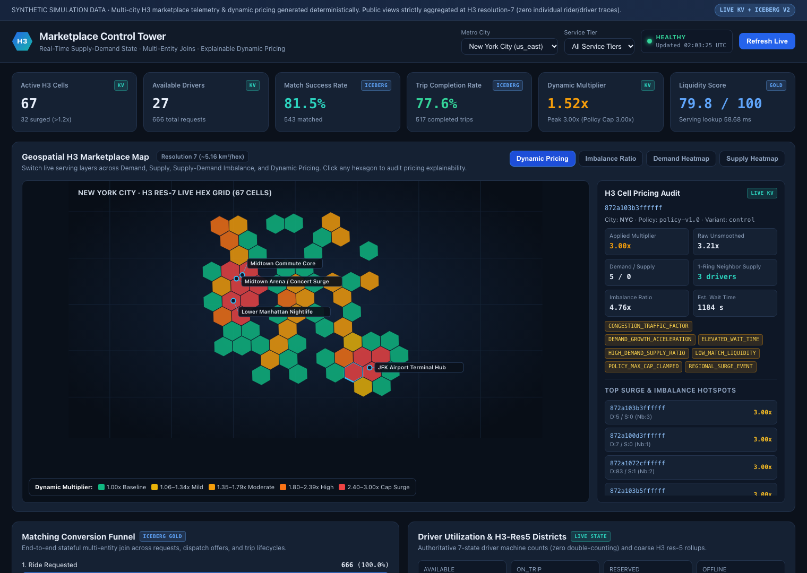
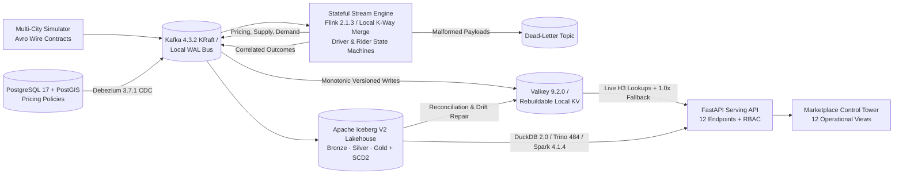
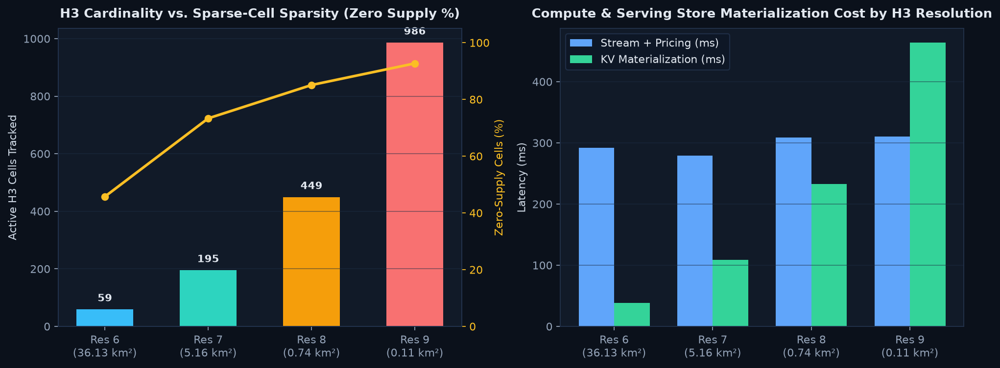

# Real-Time Mobility Marketplace & Dynamic Pricing Platform

An open-source distributed data engineering platform for multi-city ride-hailing marketplace state, stateful multi-entity streaming joins, explainable H3 dynamic pricing, and low-latency serving backed by an Apache Iceberg V2 lakehouse. Under local single-node execution, the platform sustains **70,590 events/s** stream processing across **1,000,000 virtual participants** (`1,500` concurrent active drivers, `3,000` concurrent riders), achieves **0.070 ms p95** serving KV pricing lookups (`4.28×` faster materialization at H3 resolution 7 vs. resolution 9), and passes **22/22 automated tests** including **9/9 chaos drills** and **8/8 data quality invariants**.



---

## Architecture, Model & Runtime Stack

The platform simulates three metropolitan marketplaces (**New York City**, **San Francisco**, **London**) with airport, stadium, downtown, and nightlife demand hotspots, and separates **low-latency serving state** from **authoritative historical analytics**:



| Layer | Distributed Open-Source Stack (Pinned) | Local Native Verification Runtime | License |
| --- | --- | --- | --- |
| Event Transport & Schemas | `apache/kafka:4.3.2`, `apicurio/apicurio-registry:3.3.5` | `LocalWalEventBus` (Murmur2, replay, lag) + `fastavro==1.13.1` | Apache-2.0 / MIT |
| Stateful Stream Processing | `flink:2.1.3-scala_2.12-java17` (SQL + PyFlink DataStream) | `MarketplaceStreamProcessor` (K-way FIFO merge, checkpoints) | Apache-2.0 |
| Geospatial & Dynamic Pricing | `h3==4.5.0` (Res 9 / 7 / 5), `shapely==2.2.0` | `h3==4.5.0`, deterministic bounded pricing engine + SRM | Apache-2.0 / BSD-3 |
| Low-Latency Serving Store | `valkey/valkey:9.2.0-alpine3.24` (`valkey==6.2.0`) | Rebuildable SQLite WAL KV (`put_versioned` CAS + `1.0x` fallback) | BSD-3 / MIT |
| Lakehouse & Batch Analytics | `quay.io/lakekeeper/catalog:v0.15.1`, `rustfs/rustfs:1.0.6`, `apache/spark:4.1.4`, `trinodb/trino:484` | `pyiceberg==0.12.0` (Format V2), `duckdb==2.0.0`, `pyarrow==25.0.1` | Apache-2.0 / MIT |
| CDC & Orchestration | `imresamu/postgis:17-3.6.1`, `quay.io/debezium/connect:3.7.1.Final`, `apache/airflow:slim-3.4.0` | CDC Policy SCD2 materializer + Airflow 3.4.0 DAG suite | PostgreSQL / Apache-2.0 |
| API, UI & Observability | `fastapi==0.163.2`, Prometheus `v3.16.0`, Grafana `13.0.14`, Loki `3.6.22`, OTel `0.166.0`, Marquez `0.51.1` | FastAPI + Control Tower UI + Prometheus `/metrics` + OpenLineage v2 | MIT / Apache-2.0 / AGPL-3.0 |

> **Execution Disclosure:** All numbers below were measured on an Apple M4 Pro workstation (macOS `arm64`, Python 3.12.8) under the `local_native` profile using real Apache Iceberg V2 tables, DuckDB 2.0 SQL, H3 4.5.0, Avro wire framing, and SQLite WAL serving storage. Distributed Docker Compose, Kubernetes, Flink, Spark, Trino, Debezium, and Airflow manifests are pinned with verified multi-arch tags and statically validated; see [`docs/compatibility.md`](docs/compatibility.md) and [`docs/limitations.md`](docs/limitations.md).

---

## Main Measured Results

### Sustained Pipeline Throughput & Serving Latency

Backed by raw measurements in [`results/benchmarks/load_profiles.json`](results/benchmarks/load_profiles.json):

| Profile | Virtual Participants (Drivers / Riders) | Active Concurrent (Drivers / Riders) | Events Processed | Producer Throughput | Stream Engine Throughput | Serving KV Lookup p50 / p95 / p99 | Iceberg Bronze / Silver+Gold | DQ Checks |
| --- | --- | --- | --- | --- | --- | --- | --- | --- |
| `smoke` | 300 (100 / 200) | 100 / 200 | 2,144 | 51,895 ev/s | 58,505 ev/s | 0.060 / 0.084 / 0.795 ms | 0.069 s / 0.053 s | 8/8 PASS |
| `local` | 6,000 (1,000 / 5,000) | 1,000 / 2,000 | 20,696 | 61,107 ev/s | 69,583 ev/s | 0.057 / **0.070** / 0.695 ms | 0.223 s / 0.056 s | 8/8 PASS |
| `stress` | 60,000 (10,000 / 50,000) | 5,000 / 10,000 | **93,002** | 61,005 ev/s | 53,221 ev/s | 0.057 / 0.071 / 0.735 ms | 0.980 s / 0.092 s | 8/8 PASS |
| `virtual-scale` | **1,000,000** (200k / 800k) | 1,500 / 3,000 | 29,548 | 62,601 ev/s | **70,590 ev/s** | 0.056 / 0.075 / 0.704 ms | 0.334 s / 0.061 s | 8/8 PASS |

### Multi-Resolution H3 Geospatial Pricing Tradeoffs (Identical 20,696-Event Workload)

Backed by raw measurements in [`results/benchmarks/h3_resolution_tradeoffs.json`](results/benchmarks/h3_resolution_tradeoffs.json):

| H3 Resolution | Avg Hex Area | Active H3 Cells | Driver Cell Transfers | Zero-Supply Cells | Serving KV Keys | KV Materialize Latency | Tradeoff Summary |
| --- | --- | --- | --- | --- | --- | --- | --- |
| Res 6 | 36.13 km² | 59 | 1,274 | 45.8% | 177 | 38.4 ms | Over-smoothed: 74.6% of cells surge (airport spikes bleed district-wide) |
| **Res 7 (Default)** | **5.16 km²** | **195** | **2,601** | **73.3%** | **585** | **108.5 ms** | **Balanced neighborhood granularity; 4.28× faster KV materialization than Res 9** |
| Res 8 | 0.74 km² | 449 | 4,219 | 85.1% | 1,347 | 232.8 ms | 2.30× more cells & 2.15× slower KV materialization vs. Res 7 |
| Res 9 | 0.11 km² | 986 | 4,607 | 92.7% | 2,958 | 463.8 ms | Severe signal sparsity (92.7% zero-supply cells) & 5.06× cardinality vs. Res 7 |

### Iceberg V2 Compaction & Chaos Verification Highlights

- **Iceberg Small-File Compaction (`bronze.raw_events`, 124,146 rows across 6 micro-batches):** Compacting `6 files -> 1 file` reduced storage from `6.11 MB` to `2.44 MB` (**-59.97% storage**, `2.50×` smaller vs. uncompacted) and cut count-scan latency from `16.34 ms` to `12.74 ms` (**-22.0%**, `1.28×` faster vs. uncompacted) with zero record loss ([`results/benchmarks/iceberg_optimizations.json`](results/benchmarks/iceberg_optimizations.json)).
- **Chaos & Fault-Injection Suite:** **9/9 scenarios passed**, including mid-stream TaskManager crash + checkpoint recovery with exact multiplier parity, serving KV outage -> safe `1.0x` fallback -> full rebuild from durable changelog topics, and serving drift detection & automatic repair ([`results/chaos/chaos_results.json`](results/chaos/chaos_results.json)).



---

## Run on Any Machine (Step-by-Step)

### Option 1 — Single-Container Portable Docker (Recommended on Any OS with Docker)

Runs the complete pipeline, Apache Iceberg V2 lakehouse, DuckDB analytics, versioned KV serving store, FastAPI API, and Control Tower UI inside one self-contained container:

```bash
git clone https://github.com/rohanluniya/realtime-mobility-marketplace-platform-main.git realtime-mobility-marketplace-platform
docker compose -f docker-compose.standalone.yml up --build
```

Open **`http://localhost:8010`** in your browser. To run the larger stress dataset on boot, set `MARKETPLACE_SIM_PROFILE=stress`.

### Option 2 — Zero-Docker Portable Script (macOS / Linux with Python 3.12+ or `uv`)

```bash
git clone https://github.com/rohanluniya/realtime-mobility-marketplace-platform-main.git realtime-mobility-marketplace-platform
./scripts/run_portable.sh local
```

Open **`http://127.0.0.1:8010`** in your browser.

### Option 3 — Reproduce Tests, Chaos Drills & Benchmarks Manually

```bash
uv sync --extra dev
.venv/bin/python services/state-materializer/run_pipeline.py --profile local --compact
.venv/bin/pytest -v
PYTHONPATH=. .venv/bin/python benchmarks/run_load_and_h3_benchmarks.py
.venv/bin/uvicorn main:app --app-dir apps/marketplace-api --host 127.0.0.1 --port 8010
```

### Option 4 — Full Distributed Stack (Docker Compose & Kubernetes)

```bash
# Core backbone (Kafka 4.3.2, Apicurio 3.3.5, Valkey 9.2.0, RustFS 1.0.6, Lakekeeper v0.15.1, PostGIS 17, API)
docker compose --profile core up -d

# Full distributed stack (+ Flink 2.1.3, Spark 4.1.4, Trino 484, Debezium 3.7.1, Airflow 3.4.0, Prometheus, Grafana, Loki, Marquez)
docker compose --profile full up -d

# Kubernetes (Namespace, Valkey StatefulSet, API Deployment, HPA, NetworkPolicy)
kubectl apply -f infra/kubernetes/marketplace-platform.yaml
```

---

## Detailed Engineering Docs & Raw Evidence

- **[`APPENDIX.md`](APPENDIX.md)** — Deep ablations, what worked vs. what did not (including negative skew-salting results on single-node DuckDB), distributed streaming bugs caught & fixed, and the full Acceptance Criteria Verification Matrix (A–V).
- **[`results/`](results/)** — Raw JSON/CSV benchmark outputs (`benchmarks/`), 9-scenario chaos report (`chaos/`), license audit & CycloneDX SBOM (`security/`).
- **Architecture & Deep Dives:** [`docs/architecture/overview.md`](docs/architecture/overview.md), [`docs/architecture/decisions/`](docs/architecture/decisions/), [`docs/pricing-engine.md`](docs/pricing-engine.md), [`docs/streaming-semantics.md`](docs/streaming-semantics.md), [`docs/geospatial-design.md`](docs/geospatial-design.md), [`docs/data-model/dimensional-model.md`](docs/data-model/dimensional-model.md), [`docs/event-contracts/contracts.md`](docs/event-contracts/contracts.md), [`docs/reliability.md`](docs/reliability.md), [`docs/security.md`](docs/security.md), [`docs/benchmarks/benchmark-report.md`](docs/benchmarks/benchmark-report.md), [`docs/incident-reports/INC-001-chaos-drill.md`](docs/incident-reports/INC-001-chaos-drill.md), [`docs/engineering-case-study.md`](docs/engineering-case-study.md), and [`docs/limitations.md`](docs/limitations.md).
