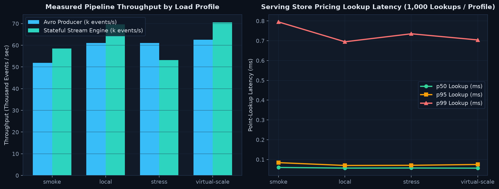
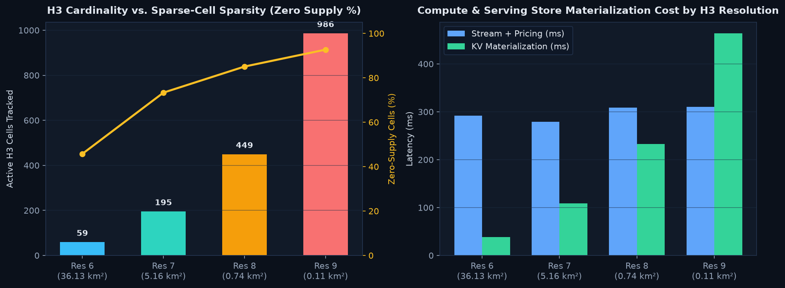

# Measured Performance, Load & H3 Geospatial Benchmark Report

All measurements in this report were captured directly by [`benchmarks/run_load_and_h3_benchmarks.py`](../../benchmarks/run_load_and_h3_benchmarks.py) and persisted as raw JSON/CSV artifacts in [`results/benchmarks/`](../../results/benchmarks/).

## Test Environment & Methodology

- **Host Hardware:** Apple M4 Pro (`arm64`), macOS Darwin 24.6.0, Python 3.12.8.
- **Execution Profile:** `local_native` (`LocalWalEventBus`, `fastavro==1.13.1`, `MarketplaceStreamProcessor`, SQLite WAL `MaterializedStateStore`, `pyiceberg==0.12.0` Format V2, `duckdb==2.0.0`, `h3==4.5.0`).
- **Measurement Scope:** Every run uses an isolated temporary directory, deterministic seed `2026`, and warm in-process Python interpreter; serving lookup latencies measure `1,000` real point lookups per load profile (and `500` per H3 resolution).

---

## 1. Sustained Load Profiles (Up to 1,000,000 Virtual Participants)

Raw artifact: [`results/benchmarks/load_profiles.json`](../../results/benchmarks/load_profiles.json) & [`.csv`](../../results/benchmarks/load_profiles.csv).

| Profile | Virtual Drivers / Riders | Active Drivers / Riders | Events Produced | Producer (ev/s, MB/s) | Stream Engine (ev/s) | Checkpoint (ms) | H3 Transfers | KV Materialize (ms) | KV Lookup p50 / p95 / p99 (ms) | Bronze / Silver+Gold (s) | Peak RSS (MB) |
| --- | --- | --- | --- | --- | --- | --- | --- | --- | --- | --- | --- |
| `smoke` | 100 / 200 | 100 / 200 | 2,144 | 51,895 (17.36) | 58,505 | 3.42 | 310 | 41.63 | 0.060 / 0.084 / 0.795 | 0.069 / 0.053 | 244.7 |
| `local` | 1,000 / 5,000 | 1,000 / 2,000 | 20,696 | 61,107 (20.61) | 69,583 | 15.20 | 2,601 | 120.28 | 0.057 / 0.070 / 0.695 | 0.223 / 0.056 | 329.0 |
| `stress` | 10,000 / 50,000 | 5,000 / 10,000 | **93,002** | 61,005 (20.92) | 53,221 | 62.60 | 8,521 | 165.08 | 0.057 / 0.071 / 0.735 | 0.980 / 0.092 | 739.6 |
| `virtual-scale` | **200,000 / 800,000** | 1,500 / 3,000 | 29,548 | 62,601 (21.28) | **70,590** | 21.44 | 3,258 | 140.50 | 0.056 / 0.075 / 0.704 | 0.334 / 0.061 | 742.7 |

### Key Takeaways
- **Virtual Identity Scale vs. Concurrent Throughput:** Expanding the simulated participant catalog from `6,000` (`local`) to `1,000,000` (`virtual-scale`) preserves `70,590 events/s` stream throughput and `0.075 ms` p95 KV lookups because stream state scales with **concurrently active entities** (`4,500` active), not total dormant registered accounts.
- **Sub-Millisecond Point Lookups:** Serving KV lookup latency stays flat across all four profiles (`0.056–0.060 ms` p50, `0.070–0.084 ms` p95, `0.695–0.795 ms` p99).

---

## 2. Multi-Resolution H3 Tradeoff Study (`res=6` vs `7` vs `8` vs `9`)

Raw artifact: [`results/benchmarks/h3_resolution_tradeoffs.json`](../../results/benchmarks/h3_resolution_tradeoffs.json) & [`.csv`](../../results/benchmarks/h3_resolution_tradeoffs.csv). All four runs consumed the exact same `20,696`-event log.

| H3 Res | Avg Area (km²) | Active Cells | Driver Transfers | Zero-Supply Cells (%) | Surged Cells (%) | Max Hot-Cell Demand | Avg Mult | Stream + Pricing (ms) | KV Keys | KV Materialize (ms) | KV Lookup p95 (ms) |
| --- | --- | --- | --- | --- | --- | --- | --- | --- | --- | --- | --- |
| 6 | 36.13 | 59 | 1,274 | 45.76% | 74.58% | 415 | 1.950x | 292.23 | 177 | 38.39 | 0.0727 |
| **7** | **5.16** | **195** | **2,601** | **73.33%** | **53.33%** | **158** | **1.602x** | **279.14** | **585** | **108.48** | **0.0822** |
| 8 | 0.74 | 449 | 4,219 | 85.08% | 34.74% | 69 | 1.536x | 308.72 | 1,347 | 232.81 | 0.0773 |
| 9 | 0.11 | 986 | 4,607 | 92.70% | 40.97% | 14 | 1.505x | 310.29 | 2,958 | 463.78 | 0.0704 |

---

## 3. Apache Iceberg V2 & Analytical Query Optimizations

Raw artifact: [`results/benchmarks/iceberg_optimizations.json`](../../results/benchmarks/iceberg_optimizations.json).

| Experiment | Baseline | Optimized | Measured Delta | Notes |
| --- | --- | --- | --- | --- |
| Iceberg Compaction (`bronze.raw_events`, 124,146 rows, 6 files -> 1 file) | `6,106,482 B` / `16.34 ms` scan | `2,444,160 B` / `12.74 ms` scan | **-59.97% storage (`2.50×` smaller)**, **-22.0% scan (`1.28×` faster)** | Compaction completed in `62.18 ms`, 0 rows lost |
| City Filter (`WHERE city_id='nyc'` on single compacted day file) | `14.17 ms` full 3-city agg | `14.68 ms` NYC-only agg | `+3.6%` (no gain on single file) | Requires `(day, city_id)` partitioning across multi-file object storage |
| 8-Way Skew Salting (`silver.fact_pricing_decision`, 195 cells on DuckDB) | `10.95 ms` unsalted | `11.62 ms` salted | `+6.1%` slower on single-node DuckDB | Exact parity verified; benefits multi-node Spark clusters with severe reducer skew |
